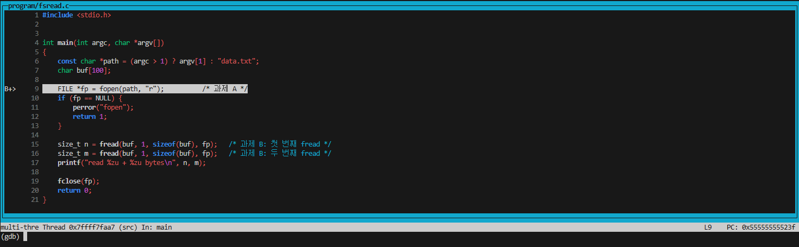

# Linux 시스템 콜 추적 과제

## 환경 세팅

### 0. 목표
```
project/
├── glibc/
└── program/
    ├── fsread.c
    ├── fsread
    └── data.txt
```

### 1. glibc 소스코드 다운로드와 과제 코드 디버깅용 컴파일
```bash
./init_environment.sh
```

### 2. 디버거로 프로그램 실행
```bash
gdb -d program/ -d glibc/ --tui --args program/fsread program/data.txt
```

`fsread.c:9` 에 중단점을 지정하고, 진행시켜 중단점에서 중단한 예시입니다.
